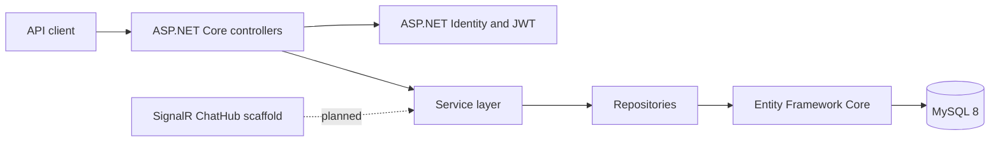

# Hatt Chat API

REST API for a chat application built with .NET 9, ASP.NET Core, Entity Framework Core, ASP.NET Identity, and MySQL.

The API covers authentication, user discovery, friend requests, and message history/sending. The React client and SignalR hub are scaffolds for planned real-time messaging and UI work.

## Features

- User registration and login with ASP.NET Identity.
- JWT bearer authentication with a two-hour token lifetime.
- User lookup by email or username.
- Friends list derived from accepted friend requests.
- Friend requests with pending, accepted, declined, and blocked states.
- Pending sent and received request lists.
- Conversation and message models with private and public conversation types.
- Message history and message sending endpoints.
- EF Core migrations with Pomelo MySQL 8.0.39.
- Global exception handling with problem details.
- OpenAPI and Scalar API reference in development.
- SignalR hub mapped at `/chat` with connection lifecycle scaffolding.
- React 19, Vite, and TypeScript frontend scaffold.

## Architecture



Controllers handle HTTP concerns, services contain application rules, and repositories isolate EF Core queries. ASP.NET Identity manages users and password hashing.

## Tech stack

| Area | Technology |
| --- | --- |
| Runtime | .NET 9 |
| Framework | ASP.NET Core Web API |
| ORM | Entity Framework Core 9 |
| Database | MySQL 8.0.39 via Pomelo |
| Identity | ASP.NET Identity |
| Auth | JWT bearer tokens |
| Real-time | SignalR packages and hub scaffold |
| API docs | Microsoft OpenAPI and Scalar |
| Frontend scaffold | React 19, Vite, TypeScript |

## Project structure

```text
Hatt/
  Authentication/  Auth service and auth controller
  Controllers/     User and conversation endpoints
  Data/            EF Core DbContext
  Dtos/            Request and response records
  Hubs/            SignalR ChatHub scaffold
  Infrastructure/  Global exception handler
  Migrations/      EF Core migrations
  Models/          User, conversation, friend request, and message models
  Repositories/    Database access
  Services/        Application logic
hattfrontend/      React and Vite frontend scaffold
Hatt.sln           Solution file
```

## Getting started

### Prerequisites

- .NET 9 SDK
- MySQL 8.0.39, or a compatible MySQL server
- Node.js 20+ if you want to run the frontend scaffold

### Setup

```bash
git clone https://github.com/TechBroAdedara/Hatt-Chat-App.git
cd Hatt-Chat-App
dotnet restore
```

Create a MySQL database, then create `Hatt/appsettings.json`:

```json
{
  "ConnectionStrings": {
    "DefaultConnection": "Server=localhost;Port=3306;Database=hatt;User=root;Password=your-password;"
  },
  "Jwt": {
    "Key": "replace-with-a-long-random-secret-at-least-32-characters",
    "Issuer": "Hatt"
  }
}
```

`Hatt/appsettings.json` and `Hatt/appsettings.Development.json` are ignored by Git so local credentials are not committed.

Apply migrations and start the API:

```bash
dotnet tool install --global dotnet-ef
dotnet ef database update --project Hatt
dotnet run --project Hatt --launch-profile http
```

- API: `http://localhost:5201`
- Scalar API reference: `http://localhost:5201/scalar/v1`
- OpenAPI document: `http://localhost:5201/openapi/v1.json`

### Frontend scaffold

```bash
cd hattfrontend
npm install
npm run dev
```

The frontend is currently the Vite starter app and is not connected to the API yet.

## API overview

All `/users` and `/conversations` endpoints require `Authorization: Bearer <token>`.

| Area | Endpoint | Notes |
| --- | --- | --- |
| Auth | `POST /api/Auth/register` | Creates an Identity user |
| Auth | `POST /api/Auth/login` | Returns a JWT |
| Users | `GET /users/email/{email}` | Look up a user by email |
| Users | `GET /users/UserName/{UserName}` | Look up a user by username |
| Users | `GET /users/friends` | List accepted friends |
| Friend requests | `POST /users/friend-requests?recieverUsername={username}` | Send a request |
| Friend requests | `PUT /users/friend-requests/{requestId}?motive=Accept` | Accept, decline, or block |
| Friend requests | `GET /users/friend-requests/recieved` | Pending received requests |
| Friend requests | `GET /users/friend-requests/sent` | Pending sent requests |
| Conversations | `GET /conversations/messages?conversationId={guid}` | Message history |
| Conversations | `POST /conversations/messages` | Send a message |
| SignalR | `/chat` | Hub scaffold |

## Data model

- `User` extends `IdentityUser` with first name, last name, conversations, and friend requests.
- `FriendRequest` links sender and receiver with a status of pending, accepted, declined, or blocked.
- `Conversation` has a name, type (`Private` or `Public`), participant count, and messages.
- `ConversationUser` joins users to conversations and records their role, join time, and leave time.
- `Message` stores the sender username, content, timestamp, and conversation ID.

## Current scope

The backend API and persistence layer are in place. The following pieces are intentionally scaffolded:

- `ChatHub` is mapped but does not yet broadcast messages.
- The React app is a starter template.
- Conversation creation is implemented in the service layer but not exposed by a controller endpoint.

## Contact

- Portfolio: [adedara-adeloro.cv](https://adedara-adeloro.cv)
- LinkedIn: [adedara-adeloro](https://www.linkedin.com/in/adedara-adeloro-813b9424b/)
- Email: [courageadedara@gmail.com](mailto:courageadedara@gmail.com)
